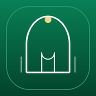

<p align="center">
  
</p>

<h1 align="center">Nurani — Al-Qur'an Digital Indonesia</h1>

<p align="center">
  <strong>Teman tilawah harian untuk membaca, menghafal, dan memahami Al-Qur'an.</strong><br />
  Aplikasi web mobile-first dengan tampilan Emerald–Gold, jadwal shalat Indonesia, doa harian, dan dukungan Progressive Web App (PWA).
</p>

<p align="center">
  
  
  
  
  
  
</p>

<p align="center">
  <a href="#fitur-utama">Lihat fitur</a> ·
  <a href="#mulai-di-lokal">Mulai di lokal</a> ·
  <a href="#deploy-ke-vercel">Deploy ke Vercel</a> ·
  <a href="#pwa-dan-mode-offline">PWA & offline</a> ·
  <a href="./docs/DEPLOYMENT_CHECKLIST.md">Checklist deployment</a>
</p>

---

## Tentang Nurani

**Nurani** dirancang untuk membantu aktivitas tilawah harian melalui satu antarmuka yang nyaman digunakan di ponsel maupun desktop. Navigasi bawah ramah satu tangan, pengaturan bacaan, mode terang/gelap, serta penyimpanan lokal membuat pengalaman membaca terasa praktis tanpa mengharuskan pengguna membuat akun.

> Fokus produk: **Tilawah · Tadabbur · Doa**

## URL surah individual dan SEO

Setiap surah memiliki halaman statis dengan URL yang mudah dibagikan, misalnya:

- `https://nurani-tiyoy.vercel.app/quran/1-al-fatihah`
- `https://nurani-tiyoy.vercel.app/quran/2-al-baqarah`
- `https://nurani-tiyoy.vercel.app/quran/36-yasin`

Next.js membangun 114 route dari metadata surah lokal. Setiap route menyediakan title, deskripsi, canonical URL, Open Graph, dan Twitter Card khusus. Daftar surah menampilkan anchor HTML yang bisa diikuti crawler, sedangkan klik normal tetap membuka pembaca di dalam aplikasi tanpa reload.

## Fitur utama

| Modul | Fitur |
|---|---|
| 📖 **Al-Qur'an** | Katalog 114 surah, pencarian dan filter Makkiyah/Madaniyah, tampilan ayat Arab, latin, dan terjemahan, serta kontrol ukuran teks. |
| 🧠 **Mode hafalan** | Sembunyikan atau tampilkan teks Arab, transliterasi, dan terjemahan secara terpisah. |
| 🔖 **Bookmark & lanjut baca** | Simpan penanda ayat, posisi terakhir, dan preferensi membaca pada perangkat. |
| 🎯 **Progres tilawah & target khatam** | Hitung ayat yang ditandai saat dibaca, pantau progres keseluruhan dan target harian, serta pilih target 30, 60, atau 90 hari. |
| 🔁 **Murajaah audio** | Ulangi audio per ayat 3×, 5×, 10×, atau tanpa batas; pilihan disimpan secara lokal. |
| 📥 **Surah offline** | Tandai surah yang telah dimuat untuk akses offline dan filter daftar surah yang ditandai. |
| 🎧 **Audio murottal** | Pilihan lima qari sesuai PRD, pemutaran surah/ayat, penyorotan ayat yang aktif, dan pemutar yang tetap mudah dijangkau. Ketersediaan audio mengikuti respons sumber data. |
| 📚 **Tafsir** | Tampilan tafsir surah/ayat berdasarkan data yang disediakan API. |
| 🕌 **Jadwal shalat** | Pencarian kota/kabupaten di Indonesia, filter wilayah pulau, dan wilayah awal **Kab. Bogor**. |
| 🤲 **Doa harian** | Pencarian doa, teks Arab, latin, terjemahan, salin bacaan, serta data cadangan lokal. |
| ✨ **Asmaul Husna** | 99 nama Allah, pencarian, dan favorit lokal. |
| 🌗 **Tema & responsivitas** | Mode terang/gelap, antarmuka mobile-first, navigasi bawah di layar kecil, dan target sentuh yang ramah pengguna. |
| 📲 **PWA** | Manifest, ikon aplikasi, prompt instalasi, service worker, halaman offline, dan cache progresif untuk sebagian data. |

## Teknologi

- **Framework:** Next.js 15.5.28 App Router dan React 19.2.9.
- **Styling:** Tailwind CSS v3 dan CSS responsif khusus aplikasi.
- **Ikon:** Lucide React.
- **Penyimpanan di perangkat:** `localStorage` untuk preferensi, bookmark, riwayat, dan data yang pernah dimuat.
- **PWA:** Web App Manifest dan service worker khusus di folder `public/`.
- **Data Al-Qur'an, doa, dan jadwal shalat:** API publik eksternal; aplikasi tidak memerlukan API key untuk endpoint bawaan.

## Mulai di lokal

### Prasyarat

- Node.js **20.9.0 atau lebih baru** (disarankan Node.js 22 LTS).
- npm.
- Koneksi internet untuk instalasi dependency dan mengambil data terbaru dari API.

### Instalasi

1. Unduh atau clone repository, lalu buka terminal pada folder yang berisi `package.json`.
2. Pasang dependency:

   ```bash
   npm install
   ```

3. Jalankan server pengembangan:

   ```bash
   npm run dev
   ```

4. Buka [http://localhost:3000](http://localhost:3000).

Setelah `npm install`, simpan `package-lock.json` ke Git agar instalasi di komputer lain dan layanan CI/deployment lebih konsisten. Lihat juga [checklist pra-deployment](./docs/DEPLOYMENT_CHECKLIST.md).

### Periksa sebelum deploy

```bash
npm run lint
npm run build
npm run start
```

`npm run start` menjalankan hasil build produksi. PWA sebaiknya diuji pada build produksi melalui HTTPS; service worker sengaja tidak digunakan pada mode development untuk mengurangi masalah cache lama.

## Environment variables

Aplikasi memiliki endpoint default sehingga `.env.local` tidak wajib untuk menjalankan versi dasar. Untuk mengganti endpoint, buat `.env.local` berdasarkan `.env.example`:

```env
NEXT_PUBLIC_QURAN_API=https://equran.id/api/v2
NEXT_PUBLIC_DOA_API=https://equran.id/api/doa
NEXT_PUBLIC_SHOLAT_API=https://api.myquran.com/v3/sholat
NEXT_PUBLIC_SITE_URL=https://nurani-tiyoy.vercel.app
```

Semua variabel di atas adalah **konfigurasi publik**, bukan tempat menyimpan secret. Variabel dengan awalan `NEXT_PUBLIC_` dapat dimasukkan ke bundle browser. Jangan menyimpan token rahasia, password, atau private API key di dalamnya. `NEXT_PUBLIC_SITE_URL` dipakai untuk canonical URL, sitemap, robots, dan pratinjau tautan; pertahankan `https://nurani-tiyoy.vercel.app` atau ganti dengan domain resmi jika nanti memakai domain khusus. Jika nilainya diubah di Vercel, jalankan deployment ulang agar build menggunakan konfigurasi terbaru.

## Publikasikan ke GitHub

Agar konfigurasi Vercel sederhana, buat repository dengan file proyek ini berada langsung di root repository—folder yang sama dengan `package.json`. Jika ZIP berisi folder `alquran-digital-nextjs`, masuk ke folder tersebut sebelum menjalankan perintah berikut.

```bash
git init -b main
git add .
git commit -m "chore: publish Nurani Al-Qur'an PWA"
git remote add origin https://github.com/USERNAME/NAMA-REPO.git
git push -u origin main
```

Ganti `USERNAME` dan `NAMA-REPO` dengan akun serta nama repository milikmu. Buat repository kosong di GitHub terlebih dahulu, lalu ikuti instruksi GitHub jika repository tersebut sudah memiliki commit awal.

**Sebelum push:** pastikan `.env.local` tidak ikut ter-commit. File `.gitignore` proyek mengabaikan file `.env*` dan tetap mengizinkan `.env.example`.

## Deploy ke Vercel

Cara termudah adalah menghubungkan repository GitHub ke Vercel. Integrasi Git dapat membuat preview deployment untuk perubahan branch dan production deployment dari branch produksi yang dipilih.

1. Push source code ke GitHub.
2. Masuk ke [Vercel Dashboard](https://vercel.com/dashboard), pilih **Add New → Project**, lalu import repository GitHub.
3. Pastikan **Root Directory** menunjuk ke folder yang berisi `package.json`. Jika isi proyek berada di root repository, gunakan `./`.
4. Periksa pengaturan build. Vercel biasanya mendeteksi Next.js secara otomatis:
   - **Framework Preset:** Next.js
   - **Build Command:** `npm run build`
   - **Output Directory:** biarkan default/dideteksi otomatis
5. Tambahkan `NEXT_PUBLIC_SITE_URL=https://nurani-tiyoy.vercel.app` di **Project Settings → Environment Variables** untuk Production (dan Preview bila perlu). Jika kelak menggunakan domain khusus, ubah nilainya ke domain kanonis tersebut. Endpoint publik tidak memerlukan key; tambahkan `NEXT_PUBLIC_QURAN_API`, `NEXT_PUBLIC_DOA_API`, dan/atau `NEXT_PUBLIC_SHOLAT_API` hanya jika ingin mengganti endpoint default.
6. Klik **Deploy** dan periksa URL deployment. Setiap push berikutnya dapat memicu deployment otomatis sesuai konfigurasi branch.

Panduan resmi: [Deploy Git Repository di Vercel](https://vercel.com/docs/git) · [Next.js di Vercel](https://vercel.com/docs/frameworks/full-stack/nextjs) · [Environment Variables Vercel](https://vercel.com/docs/environment-variables).

### Pembaruan keamanan dan versi framework

`package.json` kini mengunci **Next.js 15.5.28**, **`eslint-config-next` 15.5.28**, **React 19.2.9**, dan **React DOM 19.2.9**. Versi ini dipilih untuk memenuhi patch keamanan Next.js yang diumumkan pada Oktober 2026. Tetap periksa advisori resmi secara berkala dan gunakan patch lebih baru yang kompatibel jika sudah tersedia.

> [!IMPORTANT]
> Dependency upgrade sudah ditulis pada konfigurasi proyek, tetapi `npm install`, lint, dan build produksi perlu dijalankan pada komputer pengembang atau CI sebelum deployment. Instalasi registry pada lingkungan penyusunan source mengalami timeout sehingga build produksi belum dapat diverifikasi di sini. Setelah instalasi berhasil, commit `package-lock.json` agar build lokal dan Vercel menggunakan resolusi dependency yang konsisten.

- [Advisori keamanan — Cyber Security Agency of Singapore, 20 Oktober 2026](https://www.csa.gov.sg/alerts-and-advisories/alerts/al-2026-148/)
- [Next.js Security Advisories](https://github.com/vercel/next.js/security/advisories)
- [Panduan resmi upgrade Next.js 15](https://nextjs.org/docs/app/guides/upgrading/version-15)

## SEO dan pratinjau tautan

Detail audit dan pemeriksaan paska-deploy tersedia di [`docs/SEO-AND-PRODUCTION-AUDIT.md`](./docs/SEO-AND-PRODUCTION-AUDIT.md).

Fondasi SEO teknis sudah disiapkan untuk halaman utama aplikasi:

- Metadata bahasa Indonesia: title, description, keywords, canonical URL, dan instruksi indexing untuk crawler. Deployment Preview Vercel diberi `noindex`; URL produksi tetap dapat diindeks.
- Open Graph dan Twitter Card memakai gambar pratinjau 1200×630 di `public/og-nurani.png`.
- Structured data `WebApplication` berbahasa Indonesia agar mesin pencari dapat memahami jenis dan fitur aplikasi.
- `src/app/robots.js` menghasilkan `/robots.txt`, sementara `src/app/sitemap.js` menghasilkan `/sitemap.xml`.
- Header keamanan dasar ditetapkan di `next.config.js`: `X-Content-Type-Options`, `Referrer-Policy`, `X-Frame-Options`, dan `Permissions-Policy`.
- Halaman pemulihan tersedia untuk URL yang tidak ditemukan (`not-found.jsx`) dan error runtime pada segmen halaman (`error.jsx`).

Halaman utama dan empat bagian utama memiliki URL tersendiri, dan seluruh 114 surah kini memiliki route statis `/quran/<nomor>-<slug>`. Setiap route surah memiliki title, deskripsi, canonical, Open Graph, dan Twitter Card masing-masing. Navigasi bawah tetap mempertahankan pengalaman mobile satu halaman; daftar surah menyediakan tautan HTML yang bisa diikuti crawler. Sitemap mencantumkan 6.355 URL: lima route utama, 114 route surah, dan 6.236 route ayat. Doa individual belum memiliki URL tersendiri.

Setelah deployment baru berhasil:

1. Buka `https://nurani-tiyoy.vercel.app/robots.txt` dan pastikan sitemap ditautkan.
2. Buka `https://nurani-tiyoy.vercel.app/sitemap.xml` dan pastikan URL kanonis benar.
3. Bagikan URL di pemeriksa pratinjau Open Graph atau kirim ke aplikasi chat untuk memeriksa kartu gambar.
4. Daftarkan properti situs di [Google Search Console](https://search.google.com/search-console/about), verifikasi kepemilikan, lalu kirim sitemap URL. Indexing tidak instan dan tidak dijamin.
5. Jalankan Lighthouse pada deployment produksi untuk melihat skor Performance, Accessibility, Best Practices, dan SEO.

**Batas audit saat ini:** Content-Security-Policy (CSP) belum dipasang karena domain API dan host audio perlu diinventarisasi dari Network/Console browser dan diuji agar tidak memutus fungsi inti. Header CSP yang terlalu ketat bisa memblokir murottal atau data API. Tambahkan setelah daftar sumber `connect-src`, `media-src`, `font-src`, dan `img-src` sudah terverifikasi.

## PWA dan mode offline

- `public/manifest.webmanifest` mengatur nama aplikasi, ikon, warna tema, mode standalone, dan shortcut.
- `public/sw.js` mengatur cache app shell, termasuk route publik `/quran`, `/jadwal-shalat`, `/doa`, dan `/asmaul-husna`, aset statis Next.js yang memakai nama ber-hash, serta respons GET yang berhasil dari beberapa endpoint API. Versi cache lama dibersihkan saat service worker baru aktif. Endpoint SEO (`/robots.txt`, `/sitemap.xml`, dan gambar Open Graph) melewati runtime cache service worker.
- Preferensi membaca, bookmark, posisi baca, daftar ayat yang telah dibaca, target khatam, mode pengulangan audio, surah yang ditandai offline, sebagian metadata/ayat yang telah dimuat, doa, dan jadwal shalat terakhir juga dapat disimpan di browser.
- **Offline bersifat progresif, bukan salinan penuh semua data.** Konten perlu berhasil dimuat saat online; dari halaman baca, gunakan **Simpan offline** untuk menandai surah dan menyimpan ayat di perangkat. Data tetap bergantung pada kapasitas penyimpanan browser dan bisa dihapus oleh pengguna/browser. Audio murottal masih dapat membutuhkan koneksi internet.
- Instalasi PWA pada deployment publik membutuhkan HTTPS. `localhost` didukung untuk pengembangan.

## Sumber data

- **Al-Qur'an, terjemahan, audio, dan tafsir:** [Dokumentasi EQuran.id API v2](https://equran.id/apidev/v2)
- **Doa harian:** [Dokumentasi EQuran.id Doa API](https://equran.id/apidev/doa)
- **Jadwal shalat Indonesia:** [Dokumentasi myQuran API](https://api.myquran.com/doc)

Data ditampilkan berdasarkan respons sumber API. Ketersediaan, struktur field, CORS, tautan audio, dan kelengkapan konten mengikuti kebijakan serta kondisi layanan tersebut. Daftar surah bawaan digunakan sebagai metadata tampilan; teks ayat penuh diambil dari API dan sebagian hasil yang berhasil dimuat dapat disimpan lokal.

## Struktur proyek

```text
alquran-digital-nextjs/
├── design-system/
│   ├── MASTER.md
│   └── UI_UX_AUDIT.md
├── docs/
│   ├── DEPLOYMENT_CHECKLIST.md
│   ├── SEO-AND-PRODUCTION-AUDIT.md
│   └── PRD.md
├── public/
│   ├── icons/
│   ├── og-nurani.png
│   ├── favicon.svg
│   ├── manifest.webmanifest
│   ├── offline.html
│   └── sw.js
├── src/
│   ├── components/
│   │   └── NuraniApp.jsx
│   ├── app/
│   │   ├── quran/page.jsx
│   │   ├── jadwal-shalat/page.jsx
│   │   ├── doa/page.jsx
│   │   ├── asmaul-husna/page.jsx
│   │   ├── globals.css
│   │   ├── error.jsx
│   │   ├── layout.jsx
│   │   ├── not-found.jsx
│   │   ├── page.jsx
│   │   ├── robots.js
│   │   └── sitemap.js
│   └── lib/
│       ├── section-routes.js
│       ├── section-metadata.js
│       ├── api.js
│       ├── data.js
│       └── site-config.js
├── .env.example
├── package.json
└── README.md
```

## Verifikasi Google Search Console

Proyek ini menyertakan file verifikasi HTML untuk properti URL-prefix `https://nurani-tiyoy.vercel.app/`. File `public/google47c4b90e54eddd18.html` harus dipertahankan dengan nama dan isi persis seperti yang diberikan Google. Setelah perubahan di-push dan deployment Vercel selesai, pastikan file dapat dibuka di:

`https://nurani-tiyoy.vercel.app/google47c4b90e54eddd18.html`

Kontennya adalah `google-site-verification: google47c4b90e54eddd18.html`. Jika URL dapat dibuka tanpa login dan menampilkan teks tersebut, kembali ke Google Search Console dan klik **Verify**. Jangan menghapus file setelah verifikasi karena Google dapat memeriksanya lagi. Metode file HTML hanya untuk properti URL-prefix; untuk properti Domain, gunakan verifikasi DNS TXT.

## Troubleshooting

<details>
  <summary><strong>Hydration error: “KAB. BOGOR” berbeda dengan “KOTA BOGOR”</strong></summary>

  Ini dapat terjadi bila browser masih menyimpan bundle atau service worker dari build sebelumnya. Buka Chrome DevTools → **Application → Service Workers** lalu unregister worker untuk `localhost:3000`. Pada **Application → Storage**, pilih **Clear site data** (ini juga menghapus bookmark dan preferensi lokal situs). Hentikan server, hapus `.next`, lalu jalankan lagi `npm run dev`.
</details>

<details>
  <summary><strong>Doa, ayat, atau jadwal tidak dimuat</strong></summary>

  Pastikan koneksi internet aktif. API eksternal dapat mengalami gangguan, perubahan struktur respons, atau pembatasan akses browser. Periksa Console/Network di DevTools dan coba kembali setelah layanan tersedia. Data cadangan lokal hanya mencakup konten yang dibundel atau pernah berhasil disimpan.
</details>

<details>
  <summary><strong>Perubahan environment variable tidak terlihat di Vercel</strong></summary>

  Pastikan variabel disetel pada environment yang benar (Preview/Production), lalu buat deployment baru. Variabel `NEXT_PUBLIC_` dibaca saat proses build dan dikirim ke sisi browser.
</details>

## Design system & roadmap

Pendekatan design-system-first dan catatan audit UI/UX ada di [`design-system/MASTER.md`](./design-system/MASTER.md) dan [`design-system/UI_UX_AUDIT.md`](./design-system/UI_UX_AUDIT.md). PRD asli tersedia di [`docs/PRD.md`](./docs/PRD.md).

Fitur lanjutan yang masih disiapkan: pencarian ayat berdasarkan topik, catatan tadabbur, warna tajwid otomatis yang bersumber dari data tepercaya, kompas kiblat, pengingat terjadwal, sinkronisasi antarperangkat, dan unduhan audio offline.

## Kontribusi

Perbaikan bug, peningkatan aksesibilitas, dan penyempurnaan dokumentasi sangat diapresiasi. Untuk perubahan yang cukup besar, buka issue terlebih dahulu agar tujuan perubahan dapat didiskusikan. Sebelum mengirim pull request, jalankan lint dan build, dan pastikan tidak ada file `.env.local` atau secret yang ikut ditambahkan.

## Lisensi

Saat ini repository belum menyertakan file `LICENSE`. Tentukan lisensi yang sesuai sebelum mengizinkan pihak lain menggunakan, memodifikasi, atau mendistribusikan ulang source code.

---

<p align="center">
  Dibuat dengan niat baik dan secangkir kopi oleh <a href="https://www.instagram.com/cecep.maulana_/" target="_blank" rel="noopener noreferrer">Cecep Maulanaツ</a>.
</p>


## Catatan perbaikan katalog doa

Katalog doa menormalkan urutan berdasarkan ID numerik yang tersedia dan memastikan **Doa sebelum makan** berada sebelum **Doa sesudah makan**. Entri khusus **Membaca basmalah sebelum makan** dikecualikan berdasarkan judul yang dinormalisasi secara tepat, tanpa menyaring doa lain yang memuat kata serupa. Katalog API atau cache yang hanya berisi satu/terlalu sedikit doa dianggap tidak lengkap dan tidak boleh menggantikan daftar yang tersedia. Service worker memakai versi cache terbaru.


## Pembaruan v1.5.0

- Slider ukuran teks Latin/transliterasi pada pengaturan bacaan (12–30 px), tersimpan di perangkat dan dipulihkan setelah aplikasi dibuka kembali.
- Tombol **Reset khatam** dengan konfirmasi, menghapus progres ayat dan catatan harian serta mengembalikan target ke 30 hari. Bookmark dan posisi bacaan terakhir tetap dipertahankan.
- Cache service worker dinaikkan ke `nurani-pwa-v14` agar aset terbaru tidak tertahan oleh cache lama.


## URL ayat yang bisa dibagikan

Versi 1.6.0 menambahkan URL langsung untuk setiap ayat dengan format `/quran/<nomor>-<slug-surah>/<nomor-ayat>`, misalnya `/quran/1-al-fatihah/1`. Tombol **Bagikan ayat** akan membuka menu berbagi di perangkat yang mendukung Web Share API atau menyalin teks ayat beserta tautannya. Saat tautan dibuka, aplikasi akan menyorot ayat tujuan. Sitemap juga mencantumkan URL ayat.
