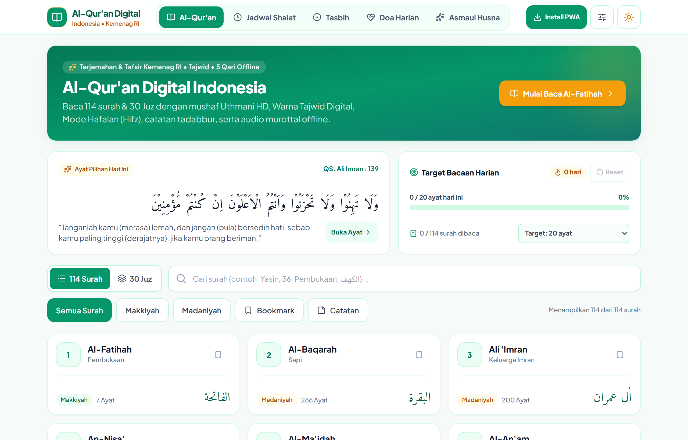
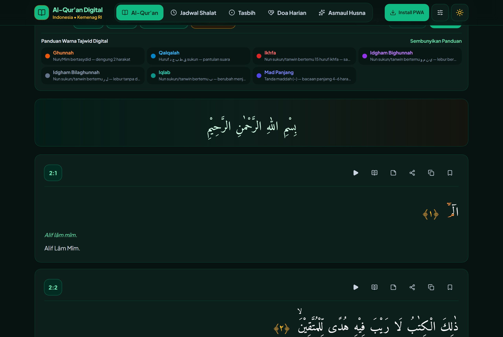
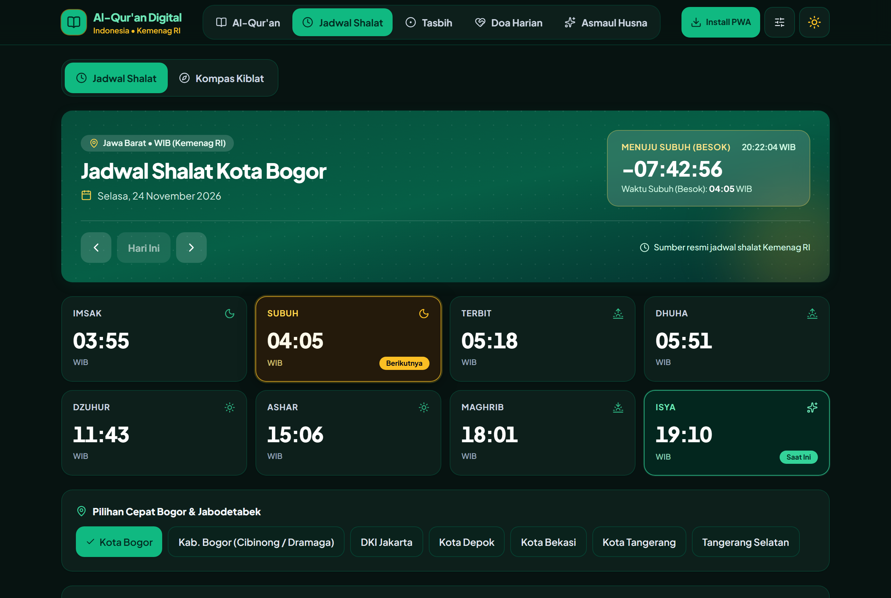
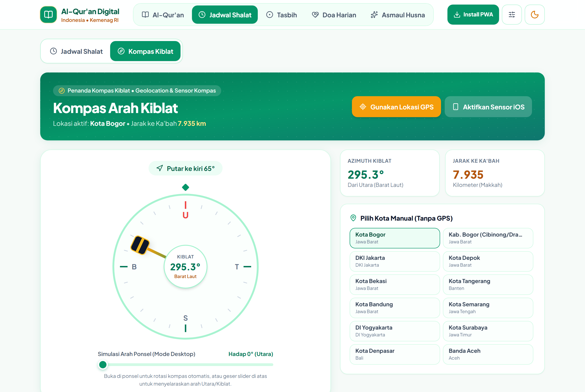
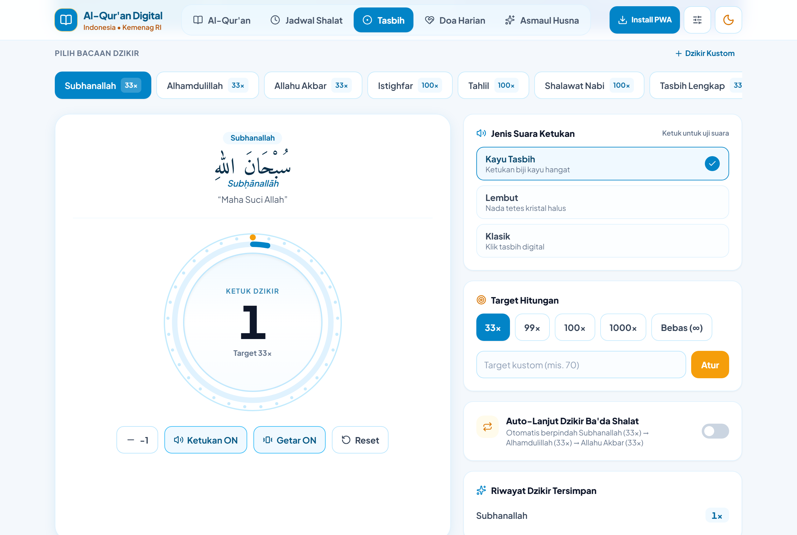
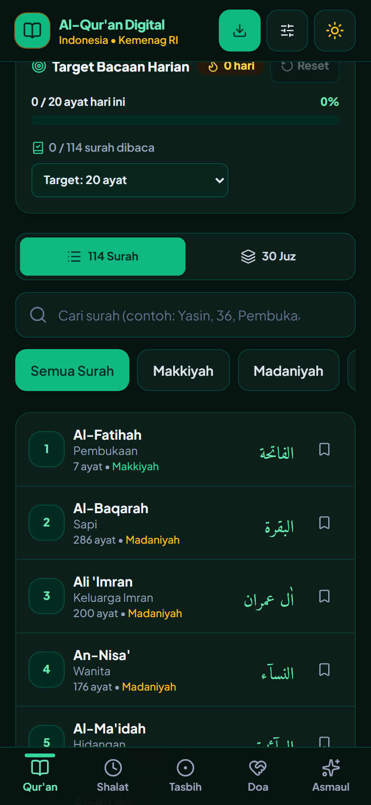

<div align="center">


# Al-Qur'an Digital Indonesia

**Aplikasi web Al-Qur'an Digital modern, *mobile-first*, dan *PWA-ready* berbasis Next.js 16** — dirancang khusus untuk kenyamanan membaca, menghafal (*Hifz*), memahami tafsir Kemenag RI, serta menemani ibadah harian masyarakat Indonesia.

[](https://nextjs.org/)
[](https://react.dev/)
[](https://tailwindcss.com/)
[](#-dukungan-pwa--mode-offline)
[](https://equran.id/)

<br />



</div>

---

## Pratinjau Antarmuka (Screenshots)

<table>
  <tr>
    <td width="50%" align="center">
      <strong>Pembaca Al-Qur'an + Warna Tajwid Digital (Dark Mode)</strong><br /><br />
      
    </td>
    <td width="50%" align="center">
      <strong>Jadwal Shalat 518 Kota Indonesia (Dark Mode)</strong><br /><br />
      
    </td>
  </tr>
  <tr>
    <td width="50%" align="center">
      <strong>Kompas Arah Kiblat (Geolocation &amp; Sensor Kompas)</strong><br /><br />
      
    </td>
    <td width="50%" align="center">
      <strong>Tasbih Digital &amp; Suara Ketukan (Tema Biru Safir)</strong><br /><br />
      
    </td>
  </tr>
</table>

<div align="center">
  <strong>Tampilan Mobile-First (Compact Surah List &amp; 5-Tab Bottom Navigation)</strong><br /><br />
  
</div>

---

## Fitur Unggulan

### 1. Al-Qur'an 114 Surah, 30 Juz & Tipografi Arab HD
- **Pencarian Real-Time & Filter Lengkap**: cari berdasarkan nama Arab, Latin, nomor surah, atau arti, lengkap dengan filter **Semua Surah**, **Makkiyah**, **Madaniyah**, **Bookmark**, dan **Catatan**.
- **Navigator 30 Juz (ODOJ)**: beralih instan antara tampilan **114 Surah** dan **30 Juz** untuk langsung melompat ke ayat awal setiap Juz.
- **Mesin Tipografi Arab HD (`cleanArabicText`)**: membersihkan karakter rusak (`\uFFFD`), *zero-width control chars*, dan *orphan glyphs* secara otomatis dengan rantai font `'Amiri Quran', 'Scheherazade New', 'Noto Naskh Arabic', 'Amiri'` (`RTL`, `line-height: 2.5`).
- **Warna Tajwid Digital**: pewarnaan otomatis 7 hukum tajwid utama (**Ghunnah, Qalqalah, Ikhfa, Idgham Bighunnah, Idgham Bilaghunnah, Iqlab, Mad Panjang**) lengkap dengan panduan warna interaktif tanpa memutus ligatur huruf Arab.
- **Mode Hafalan (*Hifz Mode*)**: sakelar independen untuk menyembunyikan/menampilkan teks **Arab**, **Pelafalan Latin**, dan **Terjemahan Indonesia** secara terpisah.
- **Pengaturan Ukuran Font Independen**: atur ukuran **Teks Arab** (`20px–52px`), **Pelafalan/Latin** (`12px–26px`), dan **Terjemahan** (`12px–24px`) dengan pratinjau langsung.
- **Interaksi Ayat Lengkap**: form **Lompat Ayat**, **Bookmark** per-surah & per-ayat, **Catatan Pribadi / Tadabbur** per-ayat, **Salin Ayat**, dan **Generator Kartu Ayat PNG** (`1080×1350`, 4 tema kartu) siap bagikan ke WhatsApp Status & Instagram Story.
- **Target Bacaan Harian & Streak**: pelacak target ayat harian (`10 / 20 / 50 / 208 ayat = 1 Juz`), tombol **Reset** berkonfirmasi 2-langkah, progres `X / 114 surah`, serta kartu **Ayat Pilihan Hari Ini**.

### 2. Audio Murottal Multi-Imam (Online & Offline)
- **5 Qari Ternama Dunia**:
  1. Sheikh Misyari Rasyid Al-Afasi
  2. Sheikh Abdurrahman As-Sudais
  3. Sheikh Abdullah Al-Juhany
  4. Sheikh Abdul Muhsin Al-Qasim
  5. Sheikh Ibrahim Al-Dossari
- **Mode Putar Lengkap**: **Full Surah** & **Per-Ayat** dengan **Auto-Next Verse**, *verse highlighting* otomatis, dan *auto-scroll* ke tengah layar.
- **Hifz Loop & Kecepatan Audio**: pengulangan ayat (`1× / 3× / 5× / ∞`) dan pengatur kecepatan (`0.75× / 1× / 1.25× / 1.5×`).
- **Unduh Audio Offline**: simpan audio murottal per surah ke *Cache Storage* dengan indikator progres agar dapat diputar tanpa internet, atau unduh langsung sebagai berkas `.mp3`.

### 3. Tafsir Resmi Kemenag RI
- Terintegrasi langsung per-ayat maupun seluruh surah dalam modal responsif yang nyaman dibaca.

### 4. Jadwal Shalat 518 Wilayah Indonesia & Kompas Kiblat
- **Cakupan Seluruh Indonesia**: pilihan cepat **Bogor & Jabodetabek** (Kota Bogor, Kab. Bogor Cibinong/Dramaga, DKI Jakarta, Depok, Bekasi, Tangerang, Tangerang Selatan) serta filter wilayah pulau (**Jawa & Bali, Sumatra, Kalimantan, Sulawesi & Nusa Tenggara, Maluku & Papua**).
- **Hitung Mundur Real-Time**: menampilkan jam lokal kota (`WIB / WITA / WIT`), hitung mundur waktu shalat berikutnya, penanda tanggal Masehi, dan navigasi antar-hari.
- **Penanda Kompas Kiblat (*Qibla Finder*)**: perhitungan arah kiblat presisi (*great-circle bearing*) & jarak ke Ka'bah (*Haversine*), dukungan **Geolocation GPS**, sensor **Device Orientation**, getar haptik saat arah tepat (`±5°`), serta 18 kota manual & simulator kompas desktop.

### 5. Tasbih Digital beserta Suara & Getar Ketukan
- **Disintesis via Web Audio API** (latensi instan & bekerja *offline*) dengan 3 pilihan suara ketukan: **Kayu Tasbih**, **Lembut**, dan **Klasik**, ditambah nada khusus saat target tercapai serta getar haptik (`Vibration API`).
- **8 Preset Dzikir & Dzikir Kustom**: Subhanallah, Alhamdulillah, Allahu Akbar, Istighfar, Tahlil, Shalawat Nabi, Tasbih Lengkap, Hauqalah, dukungan tombol **Spasi** di desktop, serta mode **Auto-Lanjut Dzikir Ba'da Shalat (`33×3`)**.

### 6. Doa Harian & 99 Asmaul Husna
- **227 Doa Harian Otentik** lengkap dengan teks Arab HD, transliterasi Latin, terjemahan Indonesia, referensi hadis, pencarian, dan filter kategori.
- **99 Asmaul Husna** dalam *grid card* interaktif dengan pencarian cepat, tombol salin, dan tampilan modal fokus.

### 7. Personalisasi, Tema Warna & Dukungan PWA
- **5 Pilihan Tema Warna**: **Hijau Zamrud**, **Biru Safir**, **Nila Malam**, **Cokelat Mushaf**, dan **Merah Delima** — seluruhnya mendukung **Light Mode** & **Dark Mode** dengan kontras tinggi.
- **PWA (*Progressive Web App*)**: tombol **Install PWA** *sticky* di topbar, `manifest.webmanifest`, dan *Service Worker* (`sw.js`) agar surah, jadwal shalat, tasbih, dan audio terunduh tetap dapat diakses saat *offline*.
- **Tanpa Login**: seluruh preferensi, bookmark, catatan tadabbur, statistik bacaan, dan riwayat tasbih tersimpan privat di `localStorage`.

---

## Tech Stack & Sumber Data

| Komponen | Teknologi / Layanan |
| :--- | :--- |
| **Framework** | Next.js 16 (App Router & Turbopack) + React 19 |
| **Styling & Tema** | Tailwind CSS v3 + CSS Custom Properties (5 Tema × Dark/Light Mode) |
| **Ikonografi** | Lucide React |
| **Tipografi Arab** | Google Fonts (`Amiri Quran`, `Scheherazade New`, `Noto Naskh Arabic`, `Amiri`) |
| **Audio Ketukan Tasbih** | Web Audio API & Vibration API |
| **PWA & Offline** | Service Worker (`sw.js`), Cache Storage API, Web App Manifest |
| **Data Al-Qur'an, Audio, Tafsir & Doa** | [EQuran.id API v2](https://equran.id/) (Standar Kemenag RI) |
| **Data Jadwal Shalat Indonesia** | [MyQuran API v2](https://api.myquran.com/) (518 Kota/Kabupaten Kemenag RI) |

---

## Struktur Proyek

```text
quran-digital/
├── docs/
│   └── screenshots/             # Screenshot desktop & mobile untuk dokumentasi
├── public/
│   ├── favicon.svg              # Ikon vektor aplikasi
│   ├── icon-192.png             # Ikon PWA 192×192
│   ├── icon-512.png             # Ikon PWA 512×512
│   ├── manifest.webmanifest     # Web App Manifest (PWA)
│   └── sw.js                    # Service Worker untuk caching & mode offline
├── src/
│   ├── app/
│   │   ├── globals.css          # Multi-theme CSS variables, Arab HD & warna Tajwid
│   │   ├── layout.jsx           # Root Layout, metadata PWA & Google Fonts
│   │   └── page.jsx             # Orkestrator utama aplikasi & navigasi responsif
│   ├── components/
│   │   ├── AsmaulHusnaView.jsx  # 99 Asmaul Husna interaktif
│   │   ├── AudioPlayerBar.jsx   # Sticky audio player, Hifz loop, speed & cache offline
│   │   ├── DoaHarianView.jsx    # 227 Doa harian + filter kategori
│   │   ├── KhatamTrackerCard.jsx# Target bacaan harian, reset & ayat pilihan hari ini
│   │   ├── PrayerTimesView.jsx  # Jadwal shalat 518 kota + sub-tab Kompas Kiblat
│   │   ├── PwaManager.jsx       # Hook install PWA, panduan perangkat & banner offline
│   │   ├── QiblaCompass.jsx     # Kompas Kiblat GPS + sensor orientasi perangkat
│   │   ├── QuranReaderView.jsx  # Reader HD, Tajwid, Hifz, Notes, Share & Offline Audio
│   │   ├── ReaderSettingsModal.jsx # Pengaturan tema warna, font Arab/Latin/Arti & Qari
│   │   ├── ShareVerseModal.jsx  # Generator kartu ayat PNG HD (Canvas)
│   │   ├── SurahListView.jsx    # Daftar 114 Surah, 30 Juz, Bookmark & Catatan
│   │   ├── TafsirModal.jsx      # Modal Tafsir Kemenag RI per-ayat & per-surah
│   │   ├── TasbihView.jsx       # Tasbih digital interaktif + suara & getar ketukan
│   │   └── VerseNoteModal.jsx   # Modal catatan pribadi / tadabbur per-ayat
│   └── lib/
│       ├── api.js               # Fetcher API + caching localStorage offline
│       ├── arabic.js            # Sanitasi teks Arab Uthmani HD (`cleanArabicText`)
│       ├── asmaulHusna.js       # Data lengkap 99 Asmaul Husna
│       ├── constants.js         # Daftar 5 Qari, 5 Tema Warna & konfigurasi default
│       ├── fallbackDuas.js      # Data cadangan doa harian offline
│       ├── juzData.js           # Pemetaan 30 Juz (ODOJ) & Ayat Pilihan Harian
│       ├── offlineAudio.js      # Unduh & putar MP3 dari Cache Storage
│       ├── qibla.js             # Formula arah Kiblat & jarak Haversine + 18 kota
│       ├── regions.js           # Klasifikasi 518 kota/kabupaten & hitung mundur shalat
│       ├── tajwid.js            # Mesin analisis 7 hukum Warna Tajwid Digital
│       ├── tasbihAudio.js       # Synthesizer suara ketukan Web Audio API & haptik
│       └── tasbihPresets.js     # Preset dzikir, target & jenis ketukan
├── next.config.js
├── tailwind.config.js
├── postcss.config.js
├── jsconfig.json
└── package.json
```

---

## Instalasi & Menjalankan Secara Lokal

### Prasyarat
- **Node.js** versi `18.18+` (disarankan Node.js `20` atau `22/24`)
- **npm** / **pnpm** / **yarn**

### Langkah Instalasi

```bash
# 1. Clone repositori ini
git clone https://github.com/tiyoy/quran-digital.git
cd quran-digital

# 2. Install seluruh dependensi
npm install

# 3. Jalankan server pengembangan (development)
npm run dev
```

Buka [http://localhost:3000](http://localhost:3000) di browser Anda.

### Build & Mode Produksi

```bash
# Membuat production build teroptimasi
npm run build

# Menjalankan server produksi
npm run start
```

---

## Deploy ke Vercel

Aplikasi ini siap di-*deploy* langsung tanpa konfigurasi *environment variable* tambahan:

1. *Push* repositori ini ke GitHub Anda.
2. Buka [vercel.com/new](https://vercel.com/new) dan pilih repositori **quran-digital**.
3. Pastikan preset framework terdeteksi sebagai **Next.js**, lalu klik **Deploy**.
4. Dalam hitungan detik, aplikasi HTTPS Anda aktif lengkap dengan fitur **PWA Install**, **Service Worker Offline**, dan **Geolocation Kompas Kiblat**.

---

## Kredit & Lisensi

- Data Al-Qur'an, Audio Murottal, Tafsir Kemenag RI, dan Doa Harian bersumber dari API publik [EQuran.id](https://equran.id/).
- Data Jadwal Shalat resmi Kemenag RI untuk 518 wilayah Indonesia bersumber dari [MyQuran API](https://api.myquran.com/).
- Dibuat dengan niat baik dan secangkir kopi oleh **[Cecep Maulanaツ](https://www.instagram.com/cecep.maulana_/)**.

Proyek ini bebas dikembangkan kembali untuk keperluan dakwah, pembelajaran, dan manfaat umat.
